<p align="center">
  <picture>
    <source media="(prefers-color-scheme: dark)" srcset="docs/assets/wordmark-dark.svg">
    
  </picture>
</p>

<p align="center"><a href="https://gilsondev.github.io/tokenpulse/">Site do projeto</a> ·
<a href="https://github.com/gilsondev/tokenpulse/releases/latest">Baixar o firmware</a></p>

Um monitor de mesa para o uso do **Claude Code** (CLI e Desktop) numa tela ESP32 com touch. Ele mostra quanto
da janela de 5 h e da semana você já usou, quantos tokens estão passando por minuto, o que cada sessão está
fazendo e quanto esse uso custaria pela API. Tudo ao vivo, pela USB, sem Wi-Fi.

<p align="center">
  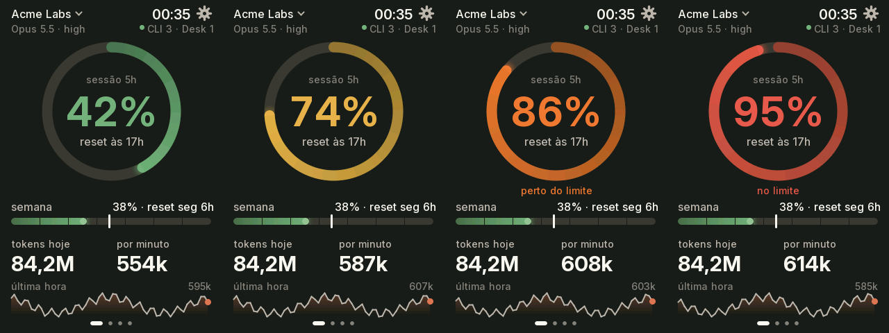
</p>

> As capturas vêm do próprio aparelho (`host/shot.sh`) com o daemon em modo demonstração: org, sessões e
> números são fictícios.

## O que ele mostra

| | | |
|:-:|:-:|:-:|
| 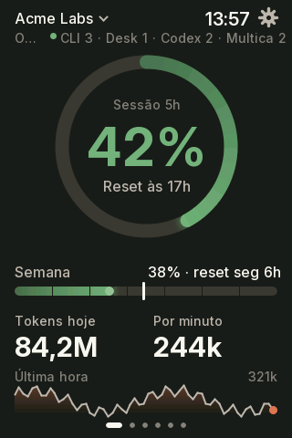 | 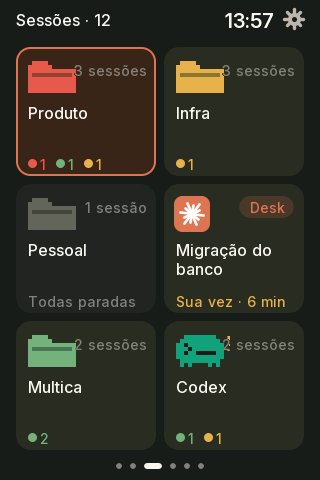 | 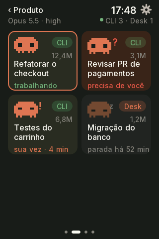 |
| **Principal**: a janela de 5 h no anel (verde, amarelo a 70%, laranja a 80%, vermelho a 90%), a semana com o ritmo esperado, tokens do dia, tokens por minuto e a última hora. | **Sessões por workspace** do [herdr](https://herdr.dev), com quantas estão trabalhando, esperando você ou na sua vez. O workspace em foco no Mac ganha borda laranja. Sem herdr, as sessões vêm dos logs e se agrupam por projeto. | **Sessões** de um workspace, cada uma com um mascote no estado dela: anda trabalhando, pula na sua vez, treme quando precisa de aprovação, dorme parada. A sessão em foco tem borda; tocar num cartão traz a sessão para a frente no Mac (o painel do herdr no seu terminal, ou o Claude Desktop). |
| 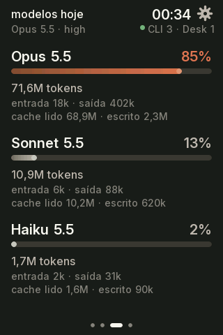 | 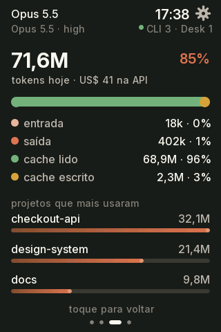 | 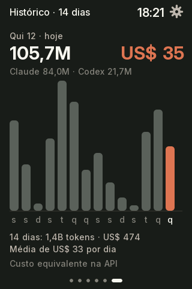 |
| **Modelos** usados hoje e a fatia de cada um. | **Detalhe do modelo**: entrada, saída e cache, custo equivalente na API e os projetos que mais usaram. | **Histórico** de 14 dias; toque numa barra para ver o dia. |
| 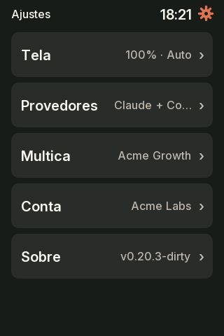 | 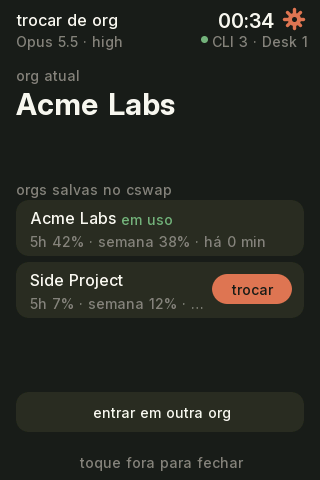 | 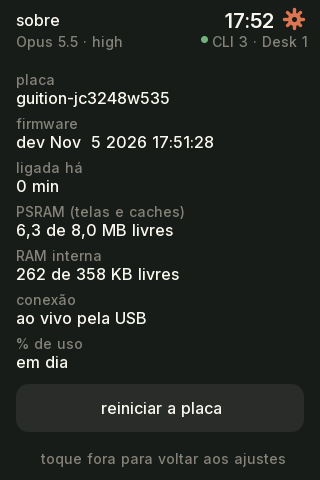 |
| **Ajustes** pela engrenagem: brilho, escurecer quando parada, tema (segue o macOS), tela em pé ou deitada, ocultar custo. | **Trocar de org** pelo nome no topo, com o último % de cada uma. Usa o [claude-swap](https://github.com/realiti4/claude-swap) e pede dois toques, porque troca o login de todas as sessões do Mac. | **Sobre**: placa, firmware, memória, conexão, reiniciar e o endereço da página web (toque para abrir o QR). |

<p align="center">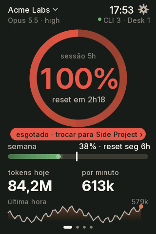</p>

Quando a janela de 5 h esgota e há outra org salva no claude-swap, a tela principal sugere a troca para a de
menor uso.

**Deitada.** Em Ajustes → Tela → horizontal, cada tela ganha uma versão deitada: o anel à esquerda, as sessões
em 3 colunas e o detalhe do modelo com os projetos ao lado.

<p align="center">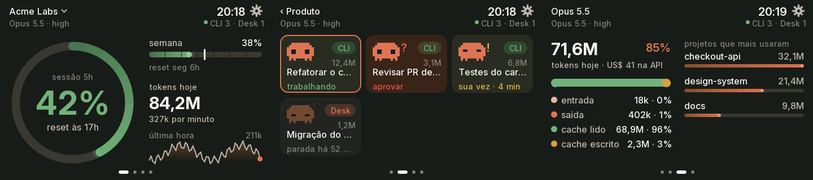</p>

**Na ESP32-2432S028R.** A placa de 2,8" (240×320, touch resistivo) roda as mesmas telas num layout
menor, em 4 posições (Ajustes → Tela: 0°, 90°, 180°, 270°), para o cabo USB sair por qualquer lado. No Sobre fica o
botão para recalibrar o toque.

<p align="center">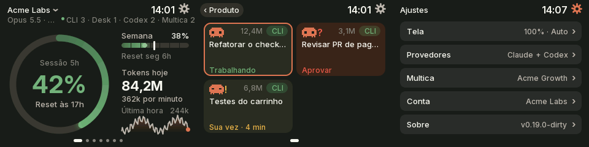</p>

**Alertas.** Quando uma sessão passa a pedir aprovação, a tela abre o workspace dela e o brilho pulsa por 20 s;
nas placas com LED ele pisca vermelho enquanto houver sessão para aprovar. Cada estado de sessão tem a sua cor:
verde trabalhando, vermelho aprovar, amarelo sua vez.

**Página web.** Guition e ESP32-2432S028R têm uma página de ajustes com mais opções que a tela: troca automática
de tela depois de N segundos sem toque, quais telas entram na volta, o alerta de aprovar, o nome na rede, as
versões do firmware e do agente, atualização guiada e "Preparar para entrega". Os dados continuam pelo cabo: o
WiFi só liga quando você pede em Ajustes → Sobre → página web, que mostra o QR para o celular entrar no WiFi da
placa e escolher a rede da casa. Depois disso a placa entra nessa rede ao ligar, e a página fica em
`http://<nome>.local`.

<table><tr>
<td width="33%"></td>
<td width="33%"></td>
<td width="33%">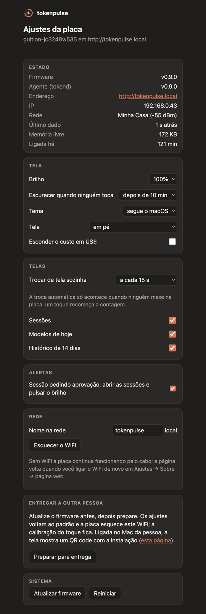</td>
</tr><tr>
<td><b>Página web</b> no Sobre: o QR do endereço <code>.local</code>, ou do WiFi da placa quando ainda não há rede.</td>
<td><b>Placa recém-recebida</b>: sem nenhum daemon no Mac, a tela de espera mostra o QR da instalação.</td>
<td><b>Ajustes pela web</b>, com dados fictícios.</td>
</tr></table>

Também tem animações com mola nas barras e no anel, halo na ponta do progresso, transições deslizando entre
as telas, modo noite (22h–7h) e uma tela de diagnóstico quando o Mac some ("cabo USB / daemon / dados").

## Sessões: com ou sem herdr

O tokenpulse acompanha qualquer sessão do Claude Code: a CLI num terminal comum, o Claude Desktop e as sessões
abertas no [herdr](https://herdr.dev). O herdr é opcional e só acrescenta detalhes:

| | Sessões comuns (terminal, Desktop) | Sessões no herdr |
|---|---|---|
| Aparecem na tela | sim, as com atividade na última hora | sim, todos os painéis abertos |
| Tokens, modelos, custo, histórico | sim (dos logs do Claude Code) | sim |
| Estado (trabalhando, sua vez, parada) | estimado pelos logs | o do herdr, na hora |
| "Precisa de você" (esperando aprovação) | — | sim |
| Agrupamento | por projeto (pasta) | pelos workspaces do herdr |
| Nome no cartão | título da sessão ou pasta | o nome que você deu à aba |
| Sessão em foco e tocar para trazer à frente | Desktop: abre o app | sim, no painel do herdr |

As duas convivem: com o herdr rodando, as sessões de fora dele aparecem num grupo "fora do herdr".

## Como funciona

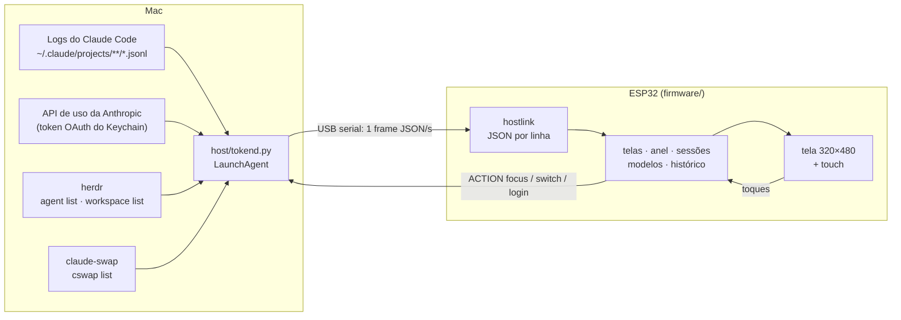

O Mac faz o trabalho pesado: o daemon `host/tokend.py` lê os logs do Claude Code, busca o % na mesma API que
o Claude Code usa e manda um frame por segundo. A placa só desenha, com fontes Inter suaves, anti-aliasing e
envio da tela em paralelo no segundo núcleo (~30 fps). As ações que a placa pede são uma lista fechada
(`focus`, `switch`, `login`): o daemon nunca executa texto vindo da serial.

## Dispositivos suportados

| Placa | Tela | Toque | Extras | Env do PlatformIO |
|---|---|---|---|---|
| [Guition JC3248W535](https://www.atomic14.com/esp32/boards/guition-jc3248w535/) (ESP32-S3 N16R8) | 3,5" IPS 320×480, AXS15231B QSPI | capacitivo | — | `guition-jc3248w535` (padrão) |
| [ESP32-2432S028R](https://github.com/witnessmenow/ESP32-Cheap-Yellow-Display), a "Cheap Yellow Display" (ESP32 sem PSRAM) | 2,8" 240×320, ST7789 | resistivo | LED RGB na cor da faixa | `cyd-2432s028r` |
| [Waveshare ESP32-S3-LCD-1.47B](https://www.waveshare.com/wiki/ESP32-S3-LCD-1.47B) | 1,47" 172×320, ST7789 | — (botão BOOT) | IMU (gira sozinha), LED RGB na cor da faixa | `waveshare-s3-lcd-147b` |
| [Waveshare ESP32-S3-Touch-AMOLED-2.16](https://docs.waveshare.com/ESP32-S3-Touch-AMOLED-2.16) | 2,16" AMOLED 480×480, CO5300 QSPI | capacitivo | IMU (gira sozinha), alto-falante, botões KEY3 e PWR (desliga), descanso contra burn-in | `waveshare-amoled-216` |
| GeekMagic SmallTV-Ultra (ESP8266, 4 MB, sem PSRAM) | 1,54" 240×240, ST7789 | — | telas que passam sozinhas, dados e OTA pelo WiFi, página de configuração | `smalltv-ultra` |

**SmallTV-Ultra.** O USB-C dele só alimenta, e o ESP8266 tem ~40 KB de heap: roda uma versão mínima à parte
([`firmware/src/smalltv/`](firmware/src/smalltv/)), sem toque. Ela alterna sozinha entre a tela principal (anel
de 5 h, semana, tokens, ritmo e a última hora), as sessões trabalhando ou esperando você (aprovar ou sua vez,
há até 1 h; depois delas, as paradas), os modelos do dia, o detalhe de cada modelo, os projetos da última hora,
o histórico de 14 dias e o % das outras orgs, e mostra o
diagnóstico "WiFi / daemon / dados" quando o Mac some. Sem som nem toque, ele chama atenção pela tela: uma sessão pedindo
aprovação segura a tela de sessões e faz o backlight pulsar, e cruzar 70/80/90% da janela de 5 h pisca o anel e
segura a principal por 2 min. O anel e as barras andam com mola, o número de tokens acende quando sobe e a troca
de tela apaga e acende o backlight.

A configuração fica numa página da própria placa, em `http://tokenpulse-XXXXXX.local` (o nome aparece na tela
de espera e pode ser trocado lá, por exemplo para `smalltv.local`): brilho, escurecer à noite, tema, rotação,
tempo em cada tela, quais telas entram na volta, os alertas e esconder o custo, além de reiniciar e esquecer o WiFi.
Em `/update` fica a atualização guiada: ela compara a versão da placa com o último release, valida o `.bin`, mostra o
progresso do envio e espera a placa voltar para confirmar a versão nova. A tela da placa mostra o progresso enquanto
grava. `GET /shot?page=main` (ou `sessions`, `models`, `model0`…`model2`, `projects`, `history`, `orgs`, `waiting`, `ota`) devolve a tela em
RGB565 cru, 240×240, para conferir o layout sem foto.

<p align="center">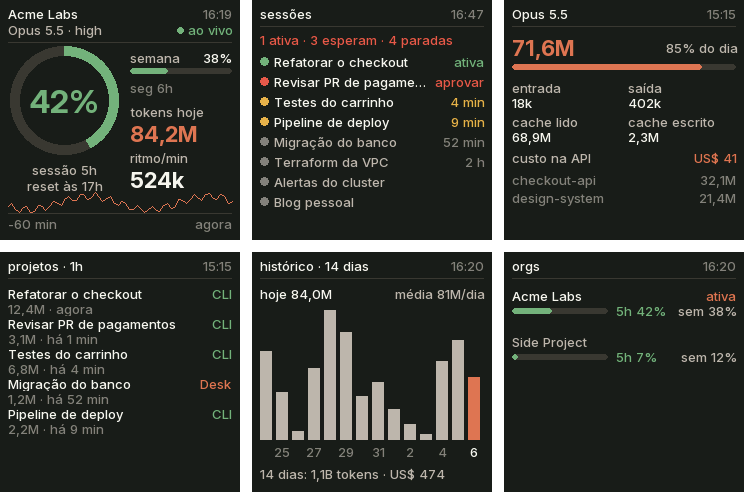</p>
<p align="center">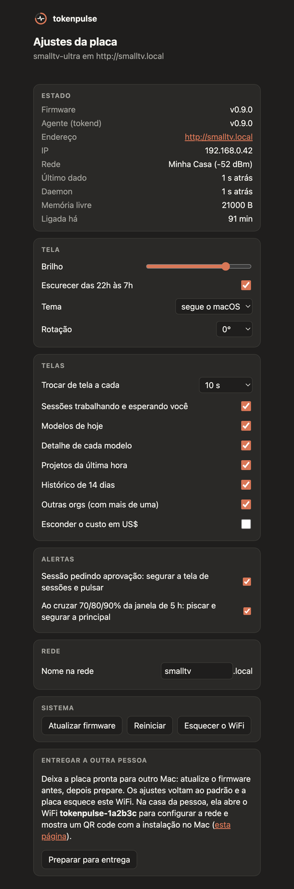</p>
Quem está na mesma rede consegue abrir a página e o `/update`, como no firmware de fábrica. A placa se anuncia por
mDNS (`_tokenpulse._tcp`) e o daemon manda a cada 2 s um frame enxuto por HTTP (`POST /frame`); o OTA também vai
pela rede (`/update`). Três travamentos seguidos no boot fazem ela subir só com WiFi e `/update`, sem a tela:
sem serial, esse é o caminho de volta.

O que falta levar do SmallTV-Ultra para as outras placas está no projeto
[tokenpulse roadmap](https://github.com/users/gilsondev/projects/3).

### Perfis: o que cada placa libera

A UI não pergunta o nome da placa. Ela decide por duas coisas:

- **A classe da tela**, pelo lado menor já girado. Abaixo de 220 px, ou sem touch, a UI é compacta: fontes
  bitmap e navegação por swipe ou botão. De 220 a 299 px é média e acima disso é grande. As duas têm todas
  as telas, os toques e a engrenagem; a média escala o layout pela altura e usa fontes de 12 a 40 px.
- **O perfil** (`board::PROFILE`, em [`boards/profile.h`](firmware/src/boards/profile.h)): `touch`, `calibrate`
  (touch resistivo), `imu` (gira sozinha), `led` (alerta de faixa), `button`, `speaker` (som no alerta de
  aprovação), `oled` (descanso e deslocamento contra burn-in) e `dense` (cabeçalho um tamanho acima). A PSRAM é lida em tempo de execução: sem ela, a tela é
  desenhada em duas faixas de meia altura, a troca de tela não desliza e o texto não fica em cache.

| Placa | Classe | touch | calibrate | imu | led | button | PSRAM |
|---|---|---|---|---|---|---|---|
| Guition JC3248W535 | grande | sim | — | — | — | sim | 8 MB |
| ESP32-2432S028R | média | sim | sim | — | sim | sim | — |
| Waveshare 1,47" | compacta | — | — | sim | sim | sim | 8 MB |
| Waveshare AMOLED 2,16" | grande | sim | — | sim | — | sim | 8 MB |

Touch resistivo (`calibrate`): na primeira vez a placa pede quatro toques com a caneta, um em cada canto, e
guarda a calibração na memória dela, que sobrevive a reinício e OTA. Para refazer: Ajustes → Sobre →
**calibrar o toque**. A leitura só vale com pressão firme e é a mediana de 5 amostras, para tirar os pulos.

A tela Sobre mostra a placa, o perfil e a memória de quem está rodando.

**AMOLED 2,16".** A interface ocupa o quadrado de 424 px do meio: os cantos do vidro são redondos. Tela OLED
marca com imagem parada, então a imagem inteira anda até 6 px por minuto e, parada, a placa entra no
descanso: fundo preto e versões resumidas das telas (relógio flip, anel de uso, sessões, modelos e 14 dias),
uma a cada 15 s, cada uma num lugar novo. Em Ajustes → Descanso dá para escolher as telas e o relógio com ou sem
segundos. Uma sessão pedindo aprovação toca um som (8 opções, com volume, em Ajustes → Som ou na página web). O
KEY3 avança a tela; o PWR entra e sai do descanso e, segurado por 2 s, desliga a placa.

**Em pé ou deitada** (Ajustes → Tela): as placas com touch têm uma versão horizontal de cada tela. O anel
vai para a esquerda, as sessões ficam em 3 colunas e os ajustes, o Sobre e a troca de org em 2. O toque gira
junto. A Guition não gira no painel: o quadro deitado é girado no envio, ainda na PSRAM.

### Como adicionar uma placa

Tudo que muda de um ESP para outro mora num header em `firmware/src/boards/`. O resto do firmware não sabe
qual placa está rodando.

1. Copie o header mais parecido para `boards/<sua_placa>.h`: `cyd_2432s028r.h` para LovyanGFX com touch,
   `waveshare_s3_lcd_147b.h` para LovyanGFX sem touch, `guition_jc3248w535.h` para outro driver.
2. Cumpra o contrato descrito em [`boards/board.h`](firmware/src/boards/board.h), dentro de `namespace board`:
   - `NAME` (igual ao env do PlatformIO; o daemon usa para achar o firmware no OTA), `DEFAULT_ROTATION`,
     `ROT_FOR`, `PROFILE` e `SERIAL_BAUD` (só conta com ponte USB-serial, como o CH340; use 460800).
   - Tela: `displayBegin`, `displaySetRotation`, `displayWidth/Height`, `setBrightness` e `displayPush`, que
     recebe linhas em RGB565 com o byte alto primeiro (o quadro inteiro com PSRAM, faixas sem). Use o driver
     que quiser (LovyanGFX, Arduino_GFX, esp_lcd).
   - Periféricos: `begin`, `gravity` (IMU), `setLed`, `buttonPressed`, `touch`. Recurso que a placa não tem vira
     função vazia (`return false`) e `false` no perfil.
3. Inclua o header no `#if` do `board.h`, com uma flag `-DBOARD_<SUA_PLACA>`.
4. Crie o env no `firmware/platformio.ini` com a flag e uma tabela de partições com duas partições de app,
   que o OTA precisa (`min_spiffs.csv` em 4 MB, `default_16MB.csv` em 16 MB).
5. Grave a primeira vez pela USB: `firmware/flash.sh <sua-placa> --usb`. Depois disso, o OTA pelo daemon.

## Releases do firmware

Os [releases](https://github.com/gilsondev/tokenpulse/releases) saem sozinhos do GitHub Actions a cada push no
`main` que traz mudança de firmware ou de daemon. A versão segue o [semver](https://semver.org/lang/pt-BR/), decidida
pelo prefixo dos commits desde o último release ([Conventional Commits](https://www.conventionalcommits.org/pt-br/)):

| Prefixo do título do commit | Versão | Exemplo |
|---|---|---|
| `feat:` | minor: v0.4.0 → v0.5.0 | `feat(smalltv): tela de histórico` |
| `fix:`, `perf:` | patch: v0.4.0 → v0.4.1 | `fix(daemon): nome de sessão sem pasta` |
| `!` depois do tipo, ou `BREAKING CHANGE:` no corpo | major: v0.4.0 → v1.0.0 | `feat!: frame novo, firmware antigo não lê` |
| `docs:`, `ci:`, `chore:`, `refactor:`, `test:`, `style:` | nenhum release | `docs: capturas do SmallTV` |

O texto depois do prefixo fica em português. O cálculo está em
[`.github/scripts/next_version.py`](.github/scripts/next_version.py) (`--test` confere as regras). Cada release traz,
por placa, `tokenpulse-<placa>-factory.bin` (primeira gravação, imagem completa a partir do 0x0) e
`tokenpulse-<placa>-ota.bin` (atualização pelo daemon). Uma tag `v*` empurrada à mão também publica. Num build local, a versão é o `git describe` (`v0.4.0-2-gdb2a673-dirty`: dois commits depois da
v0.4.0, com mudanças não commitadas), e o `update.sh` não troca esse firmware pelo release sem `--force`.

## Instalação

**Recebeu uma placa já gravada?** No Mac, um comando instala o daemon (o `uv`, se faltar, e o último release em
`~/.local/share/tokenpulse`) e o liga no login, sem clonar o repositório nem pedir senha:

```bash
curl -fsSL https://gilsondev.github.io/tokenpulse/install.sh | bash
```

O passo a passo para quem recebe, com o WiFi do SmallTV, fica em
[gilsondev.github.io/tokenpulse/comecar](https://gilsondev.github.io/tokenpulse/comecar/). O SmallTV mostra um QR
code para essa página enquanto nenhum daemon falou com ele, e o botão "Preparar para entrega" da página de
configuração volta os ajustes ao padrão e esquece o WiFi antes de você entregar a placa. Para remover:
`curl -fsSL https://gilsondev.github.io/tokenpulse/install.sh | bash -s -- --uninstall`.

**Gravar uma placa do zero:**

Requisitos no Mac: [uv](https://docs.astral.sh/uv/) e o Claude Code logado (`claude auth status`). Para
compilar o firmware em vez de usar o release, também o [PlatformIO](https://platformio.org/)
(`uv tool install platformio`).

Recomendados:
- [herdr](https://herdr.dev), para o estado real de cada sessão e o agrupamento por workspace. Instale a
  integração com `herdr integration install claude`. Sem herdr, o estado vem de uma estimativa pelos logs e as
  sessões ficam num grupo só.
- [claude-swap](https://github.com/realiti4/claude-swap) (`uv tool install claude-swap`), para trocar de org pela
  tela. Logado em cada org, rode `cswap add`.

Com a placa plugada:

```bash
git clone https://github.com/gilsondev/tokenpulse && cd tokenpulse
./setup.sh cyd-2432s028r      # ou guition-jc3248w535, waveshare-s3-lcd-147b
```

O `setup.sh` pausa o daemon se ele já roda, acha a porta da placa, grava o firmware do último release pela
USB (com o `--chip` certo, via `uvx esptool`) e liga o daemon no login do macOS (log em
`~/Library/Logs/tokenpulse.log`). Em alguns segundos a placa sai de "sem dados do Mac". A ESP32-2432S028R, de
touch resistivo, pede na primeira vez quatro toques com a caneta para calibrar. Gravar de novo apaga os ajustes
e a calibração.

O daemon roda direto da pasta clonada: mantenha a pasta onde está. Se mover ou apagar, a placa fica em "sem
dados do Mac"; para mudar de lugar, rode `host/install.sh` de novo a partir da pasta nova.

Atualizações depois disso vão por OTA, pelo mesmo cabo, e mantêm os ajustes e a calibração:

```bash
./update.sh                                    # todas as placas plugadas que estão atrás do último release
firmware/flash.sh cyd-2432s028r                # ou compila com o PlatformIO e manda (~40 s; Guition ~15 s)
firmware/flash.sh cyd-2432s028r --usb          # primeira gravação compilando da fonte, sem o release
```

O `update.sh` lê a versão de cada placa no que o daemon registrou (`~/.claude/esp-tokens-boards.json`),
baixa o `tokenpulse-<placa>-ota.bin` das que estão atrás e espera cada uma voltar na versão nova.

**SmallTV-Ultra, a primeira vez (sem abrir a caixa).** Com o daemon já instalado (`host/install.sh`):

1. Baixe o [`tokenpulse-smalltv-ultra-ota.bin`](https://github.com/gilsondev/tokenpulse/releases/latest/download/tokenpulse-smalltv-ultra-ota.bin)
   do último release. Para compilar: `cd firmware && pio run -e smalltv-ultra`.
2. No painel de fábrica, abra `http://<ip-do-smalltv>/update` e envie o `.bin` (compilado, é o
   `firmware/.pio/build/smalltv-ultra/firmware.bin`). Ele cabe no espaço de OTA do
   firmware de fábrica (~460 KB). Isso substitui o firmware da GeekMagic, que não volta sem o `.bin` dele.
3. Sem rede salva, a placa abre o WiFi aberto `tokenpulse-XXXXXX` e mostra um QR code que faz o celular entrar
   nele. A página de configuração abre sozinha (portal cativo; senão, `http://192.168.4.1`): ela lista as redes que a
   placa enxerga com o sinal de cada uma, pede a senha e diz se conectou, com o endereço `.local`, ou o que deu
   errado (senha, rede fora de alcance ou de 5 GHz). Em ~20 s o daemon acha a placa e a tela sai de "sem dados do Mac".

Depois disso o `update.sh` e o `firmware/flash.sh smalltv-ultra` atualizam pelo WiFi. Não use o WiFi do Mac
para entrar no `tokenpulse-XXXXXX`: sem cabo de rede, o Mac fica sem internet enquanto estiver nele.

Opcional: aponte o `statusLine` do `~/.claude/settings.json` para `host/statusline.sh` (passe a sua statusline
atual como argumento para encadear). Ela serve de reserva do % quando a API de uso responde 429.

## Uso

- Arraste para os lados para trocar de tela; para cima e para baixo para ver mais sessões.
- Toque num workspace para ver as sessões e no título para voltar. Toque num modelo para o detalhe.
- Arraste da borda de baixo para cima (ou segure) para voltar à principal de qualquer tela.
- Toque no nome da org para trocar de org; na engrenagem para os ajustes.
- `uv run host/tokend.py --demo` manda dados fictícios, como nas capturas acima
  (`TOKENPULSE_DEMO_P5=86` muda o % da janela de 5 h).
- `host/shot.sh saida.png "page 1" "tap 80 90"` tira um screenshot da placa
  (comandos: `page N`, `tap X Y`, `swipe L|R|U|D`). Por padrão só funciona com o daemon em `--demo`; com os seus
  dados reais, rode `REAL=1 host/shot.sh …` e confira a imagem antes de publicar: ela mostra org, títulos de
  sessão e custos.
- `uv run host/tokend.py --once` imprime um frame com os seus dados reais: não cole em issues.

## Suporte de mesa

Em [`hardware/stand/alternativa`](hardware/stand/alternativa) há um suporte inclinado sem parafuso para a
Waveshare de 1,47", em OpenSCAD, inspirado no
[Waveshare ESP32-C6 1.47 Landscape stand](https://makerworld.com/en/models/3408098).

## Problemas conhecidos

- **A placa liga mas o Mac não a vê:** o USB-C da JC3248W535 só passa dados num dos lados. Gire o plugue.
- **Mais de uma placa plugada:** o `flash.sh --usb` grava na porta que já roda aquela placa ou na única sem o
  tokenpulse. Com duas placas novas, passe `--port /dev/cu.…`.
- **Outros aparelhos seriais plugados (Arduino, outro ESP32):** o daemon abre uma vez cada porta CH340 ou
  CP210x para perguntar se é uma placa do tokenpulse, e abrir a porta reinicia muitas dessas placas. Isso
  acontece quando a porta aparece e quando o daemon reinicia (`install.sh`, fim do `flash.sh --usb`). Uma
  ESP32 com USB nativa (S3) de outro projeto não reinicia, mas a porta dela é aberta de 5 em 5 s no primeiro
  minuto depois do plug e de 60 em 60 s depois disso, o que pode atrapalhar uma gravação. Para
  mexer em outro projeto serial sem interferência, pare o daemon:
  `launchctl bootout gui/$UID/com.gilsondev.tokenpulse` (e `host/install.sh` para religar).
- **Placa com ponte USB-serial plugada antes de ter o firmware:** pelo motivo acima, o daemon não pergunta de
  novo até ela ser replugada. O `flash.sh --usb` reinicia o daemon no fim, então o fluxo normal não esbarra nisso.
- **Placa não volta depois do OTA:** o `flash.sh` avisa quando ela não se apresenta em 75 s. Um firmware que
  trava no boot do S3 pode travar também o reset pela USB, e aí nem o `--usb` grava. O JTAG embutido na USB
  do S3 ainda funciona, sem botão e sem abrir o case:
  `pio pkg install -g -t platformio/tool-openocd-esp32` e depois
  `openocd -f board/esp32s3-builtin.cfg -c "program_esp firmware.bin 0x10000 verify reset exit"`
  (grave também `bootloader.bin` em 0x0, `partitions.bin` em 0x8000 e o `boot_app0.bin` em 0xe000 para voltar à
  partição de app 0).
- **Screenshot da CYD falha às vezes:** pelo CH340 o macOS perde alguns bytes da placa para o Mac. O daemon
  tenta de novo; o OTA e os frames vão no outro sentido e não sofrem com isso.
- **"atualizado há N min" no anel:** a API de uso respondeu 429. O daemon respeita o `Retry-After` (ou dobra a
  espera, até 30 min) e guarda o último % em `~/.claude/esp-tokens-usage.json`.
- **"janela nova · 17h" com 0%:** a janela de 5 h acabou de virar; o primeiro % aparece em alguns minutos.
- **Gravar por cima do firmware [Tessera](https://github.com/gilsondev/Tessera):** ele trava o CS da tela com
  `gpio_hold`, e o firmware daqui solta a trava no boot. Para entrar no bootloader sem botões, mande `FLASH` pela
  serial e abra a porta a 1200 baud.
- **Custo:** é o equivalente pela tabela de preços da API, não o que a assinatura cobra.

## Licença

[MIT](LICENSE). A fonte Inter em `firmware/tools/fonts` e os headers gerados dela seguem a SIL OFL 1.1.

## Créditos

[LovyanGFX](https://github.com/lovyan03/LovyanGFX), [Arduino_GFX](https://github.com/moononournation/Arduino_GFX),
[ArduinoJson](https://arduinojson.org/), [SensorLib](https://github.com/lewisxhe/SensorLib), a fonte
[Inter](https://rsms.me/inter/) (SIL OFL 1.1, `firmware/tools/fonts/OFL.txt`) e os sons do
[Interface Sounds](https://kenney.nl/assets/interface-sounds), da [Kenney](https://www.kenney.nl) (CC0,
`firmware/data/sounds/LICENSE-kenney.txt`). O driver do ES8311 em `firmware/lib/ES8311` é da Espressif
(Apache-2.0), e a configuração do áudio e da PMU da AMOLED veio do
[claude-desktop-buddy-esp32](https://github.com/vthinkxie/claude-desktop-buddy-esp32) (MIT). Feito com o Claude Code.
