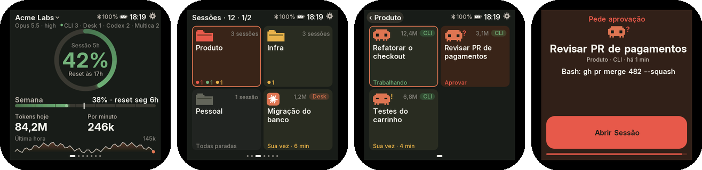
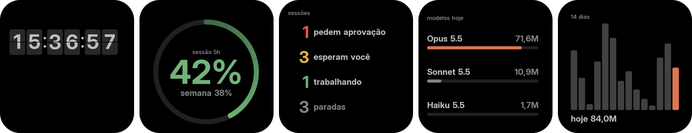
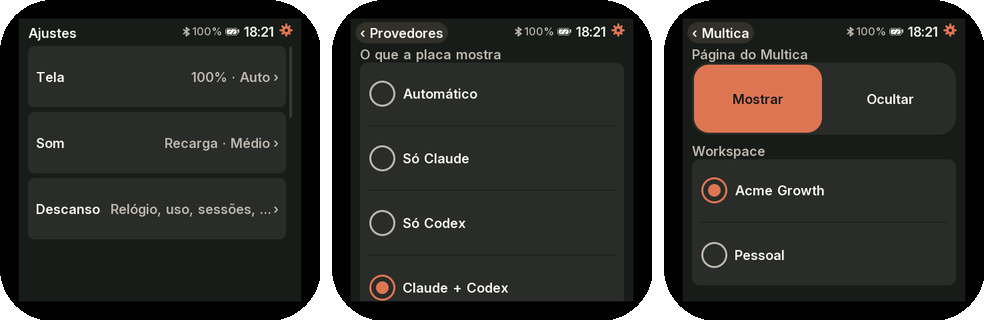
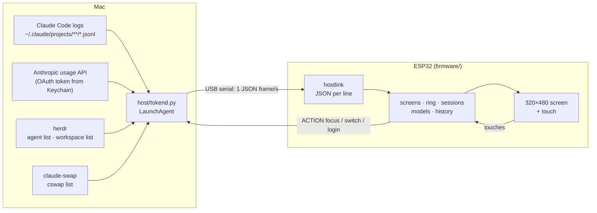

<p align="center">
  <picture>
    <source media="(prefers-color-scheme: dark)" srcset="docs/assets/wordmark-dark.svg">
    
  </picture>
</p>

<p align="center"><a href="https://gilsondev.github.io/tokenpulse/en/">Project site</a> ·
<a href="https://github.com/gilsondev/tokenpulse/releases/latest">Download the firmware</a> ·
<a href="README.pt-BR.md">Português</a></p>

A desk monitor for **Claude Code** usage (CLI and Desktop) on an ESP32 touch screen. It shows how much of the
5-hour window and of the week you have used, how many tokens flow per minute, what each session is doing and
what that usage would cost through the API. All live, over USB, no Wi-Fi.

> The on-device UI is in Brazilian Portuguese.

<p align="center">
  
</p>

> The screenshots come from the device itself (`host/shot.sh`) with the daemon in demo mode: org, sessions and
> numbers are fictitious.

## What it shows

| | | |
|:-:|:-:|:-:|
|  |  |  |
| **Main**: the 5-hour window on the ring (green, yellow at 70%, orange at 80%, red at 90%), the week against the expected pace, today's tokens, tokens per minute and the last hour. | **Sessions by workspace** from [herdr](https://herdr.dev), in pages with as many cards as the screen fits: the folder takes the color of its most urgent state and counts who is working, waiting for you or on your turn. Claude Desktop sits in a fixed workspace at the end; with a single session, the card is the session itself. Without herdr, sessions are grouped by project. | **Sessions** of a workspace, in pages, by priority (approve, working, your turn, idle), each with a mascot in its state. The "‹ workspace" title goes back to the list; tapping a card brings the session to the front on the Mac (the herdr pane in your terminal, or Claude Desktop). |
|  |  |  |
| **Models** used today and each one's share. | **Model detail**: input, output and cache, equivalent API cost and the projects that used it most. | **History** of 14 days; tap a bar to see the day. |
|  |  |  |
| **Settings** from the gear, as a list of groups like on a phone: Display (brightness, dimming, theme, orientation, cost), Sound and Screensaver on boards that have them, Account and About. | **Switch org** from the name at the top, with each org's last %. It uses [claude-swap](https://github.com/realiti4/claude-swap) and asks for two taps, because it switches the login of every session on the Mac. | **About**: board, firmware, memory, connection, restart and the web page address (tap to open the QR). |

<p align="center"></p>

When the 5-hour window runs out and there is another org saved in claude-swap, the main screen suggests
switching to the one with the lowest usage.

**Landscape.** In Settings → Display → horizontal, every screen gets a landscape version: the ring on the
left, sessions in 3 columns and the model detail with the projects beside it.

<p align="center"></p>

**On the ESP32-2432S028R.** The 2.8" board (240×320, resistive touch) runs the same screens in a smaller
layout, in 4 orientations (Settings → Display → USB cable side: bottom, right, top, left). Sessions come in
compact cards, 6 per page in portrait and 4 in landscape. About has the button to recalibrate the touch.

<p align="center"></p>

**On the Waveshare AMOLED 2.16".** The 480×480 screen has round corners: the UI fills the square in the
middle, rotates by itself with the accelerometer and runs at ~29 frames per second. When idle it enters the
screensaver, which cycles through condensed versions of the screens (flip clock, usage ring, sessions, models
and 14 days) on a black background, each in a new spot, so the glass doesn't burn in. It uses the rest of the
board's hardware:

- **Battery:** the icon in the header shows the charge and whether the board is on USB. About shows the
  percentage and the estimated time to a full charge. Charging stops at 4.1 V instead of 4.2 V, so the battery
  lasts more cycles.
- **Bluetooth:** off the cable, the board keeps receiving data wirelessly, over an encrypted link. The Mac
  learns its name ("TokenPulse AMOLED" plus the end of its WiFi name) on the first USB connection. If the board
  is fully erased, remove it in the Mac's Bluetooth settings to pair again.
- **Clock** kept in the RTC, and the daily history on a **microSD card**, beyond the 14 days the Mac sends.
- **Sound:** an alert when a session asks for approval and sounds for the 5-hour window used up or renewed,
  the week used up, low battery, Mac without data and Bluetooth. The BOOT button mutes for 1 h.

<p align="center"></p>
<p align="center"></p>
<p align="center"></p>

**Alerts.** When a session starts asking for approval, touch boards show a page with the session, what it is
asking and the Open Session button, which brings the window to the front on the Mac. The brightness pulses for
20 s; on boards with an LED it blinks red while a session waits for approval. Each session state has its color:
green working, red approve, yellow your turn.

**Web page.** Guition and ESP32-2432S028R have a settings page with more options than the screen: automatic
screen change after N seconds without touch, which screens join the rotation, the approval alert, the network
name, the firmware and agent versions, guided update and "Prepare for handover". Data still goes over the
cable: WiFi only turns on when you ask for it in Settings → About → web page, which shows the QR for the phone
to join the board's WiFi and pick the home network. After that the board joins that network on boot, and the
page lives at `http://<name>.local`.

<table><tr>
<td width="33%"></td>
<td width="33%"></td>
<td width="33%"></td>
</tr><tr>
<td><b>Web page</b> in About: the QR of the <code>.local</code> address, or of the board's WiFi when there is no network yet.</td>
<td><b>Freshly received board</b>: with no daemon on the Mac, the waiting screen shows the install QR.</td>
<td><b>Settings on the web</b>, with fictitious data.</td>
</tr></table>

There are also spring animations on the bars and the ring, a glow at the tip of the progress, sliding
transitions between screens, night mode (10 pm–7 am) and a diagnostic screen when the Mac goes away ("USB
cable / daemon / data").

## Sessions: with or without herdr

tokenpulse tracks any Claude Code session: the CLI in a plain terminal, Claude Desktop and sessions open in
[herdr](https://herdr.dev). herdr is optional and only adds detail:

| | Plain sessions (terminal, Desktop) | Sessions in herdr |
|---|---|---|
| Show on screen | yes, those active in the last hour | yes, every open pane |
| Tokens, models, cost, history | yes (from Claude Code logs) | yes |
| State (working, your turn, idle) | estimated from logs | herdr's, live |
| "Needs you" (waiting for approval) | — | yes |
| Grouping | by project (folder) | by herdr workspace |
| Name on the card | session title or folder | the name you gave the tab |
| Focused session and tap to bring forward | Desktop: opens the app | yes, in the herdr pane |

Both coexist: with herdr running, sessions outside it show up in an "Fora do herdr" (outside herdr) group.

## How it works



The Mac does the heavy lifting: the `host/tokend.py` daemon reads the Claude Code logs, fetches the % from the
same API Claude Code uses and sends one frame per second. The board only draws, with smooth Inter fonts,
anti-aliasing and the screen pushed in parallel on the second core (~30 fps). The actions the board asks for
are a closed list (`focus`, `switch`, `login`): the daemon never runs text coming from the serial port.

## Supported devices

| Board | Screen | Touch | Extras | PlatformIO env |
|---|---|---|---|---|
| [Guition JC3248W535](https://www.atomic14.com/esp32/boards/guition-jc3248w535/) (ESP32-S3 N16R8) | 3.5" IPS 320×480, AXS15231B QSPI | capacitive | — | `guition-jc3248w535` (default) |
| [ESP32-2432S028R](https://github.com/witnessmenow/ESP32-Cheap-Yellow-Display), the "Cheap Yellow Display" (ESP32 without PSRAM) | 2.8" 240×320, ST7789 | resistive | RGB LED in the band color | `cyd-2432s028r` |
| [Waveshare ESP32-S3-LCD-1.47B](https://www.waveshare.com/wiki/ESP32-S3-LCD-1.47B) | 1.47" 172×320, ST7789 | — (BOOT button) | IMU (auto-rotates), RGB LED in the band color | `waveshare-s3-lcd-147b` |
| [Waveshare ESP32-S3-Touch-AMOLED-2.16](https://docs.waveshare.com/ESP32-S3-Touch-AMOLED-2.16) | 2.16" AMOLED 480×480, CO5300 QSPI | capacitive | IMU (auto-rotates), speaker, KEY3 and PWR buttons (power off), burn-in screensaver | `waveshare-amoled-216` |
| GeekMagic SmallTV-Ultra (ESP8266, 4 MB, no PSRAM) | 1.54" 240×240, ST7789 | — | screens that cycle by themselves, data and OTA over WiFi, configuration page | `smalltv-ultra` |

**SmallTV-Ultra.** Its USB-C only powers the board, and the ESP8266 has ~40 KB of heap: it runs a separate
minimal build ([`firmware/src/smalltv/`](firmware/src/smalltv/)), without touch. It cycles by itself through
the main screen (5-hour ring, week, tokens, pace and the last hour), the sessions working or waiting for you
(approve or your turn, up to 1 h old; after them, the idle ones), today's models, each model's detail, the
projects of the last hour, the 14-day history and the % of the other orgs, and shows the "WiFi / daemon /
data" diagnostic when the Mac goes away. With no sound or touch, it gets your attention through the screen: a
session asking for approval holds the sessions screen and makes the backlight pulse, and crossing 70/80/90% of
the 5-hour window blinks the ring and holds the main screen for 2 min. The ring and bars move with springs, the
token count lights up when it rises, and a screen change fades the backlight out and in.

Configuration lives on a page on the board itself, at `http://tokenpulse-XXXXXX.local` (the name shows on the
waiting screen and can be changed there, for example to `smalltv.local`): brightness, night dimming, theme,
rotation, time on each screen, which screens join the rotation, the alerts and hiding the cost, plus restart
and forget WiFi. `/update` has the guided update: it compares the board's version with the latest release,
validates the `.bin`, shows the upload progress and waits for the board to come back to confirm the new
version. The board's screen shows the progress while it writes. `GET /shot?page=main` (or `sessions`,
`models`, `model0`…`model2`, `projects`, `history`, `orgs`, `waiting`, `ota`) returns the screen as raw RGB565,
240×240, to check the layout without a photo.

<p align="center"></p>
<p align="center"></p>
Anyone on the same network can open the page and `/update`, as with the factory firmware. The board announces
itself over mDNS (`_tokenpulse._tcp`) and the daemon sends a slim frame over HTTP every 2 s (`POST /frame`);
OTA also goes over the network (`/update`). Three crashes in a row at boot make it start with only WiFi and
`/update`, without the screen: with no serial port, that is the way back.

What is still missing to bring from the SmallTV-Ultra to the other boards is in the
[tokenpulse roadmap](https://github.com/users/gilsondev/projects/3) project.

### Profiles: what each board unlocks

The UI doesn't ask for the board's name. It decides by two things:

- **The screen class**, by the shorter side after rotation. Below 220 px, or without touch, the UI is
  compact: bitmap fonts and navigation by swipe or button. From 220 to 299 px it is medium and above that it
  is large. Both have every screen, the touches and the gear; medium scales the layout by height and uses fonts
  from 12 to 40 px.
- **The profile** (`board::PROFILE`, in [`boards/profile.h`](firmware/src/boards/profile.h)): `touch`,
  `calibrate` (resistive touch), `imu` (auto-rotates), `led` (band alert), `button`, `speaker` (sound on the
  approval alert), `oled` (screensaver and burn-in shift) and `dense` (header one size up). PSRAM is read at
  runtime: without it, the screen is drawn in two half-height bands, screen changes don't slide and text isn't
  cached.

| Board | Class | touch | calibrate | imu | led | button | PSRAM |
|---|---|---|---|---|---|---|---|
| Guition JC3248W535 | large | yes | — | — | — | yes | 8 MB |
| ESP32-2432S028R | medium | yes | yes | — | yes | yes | — |
| Waveshare 1.47" | compact | — | — | yes | yes | yes | 8 MB |
| Waveshare AMOLED 2.16" | large | yes | — | yes | — | yes | 8 MB |

Resistive touch (`calibrate`): the first time, the board asks for four taps with the stylus, one in each
corner, and stores the calibration in its memory, which survives restarts and OTA. To redo it: Settings →
About → **calibrar o toque** (calibrate touch). A reading only counts with firm pressure and is the median of 5
samples, to remove jumps.

The About screen shows the running board, profile and memory.

**AMOLED 2.16".** The UI fills the 424 px square in the middle: the glass corners are round. An OLED screen
burns in with a still image, so the whole image moves up to 6 px per minute and, when idle, the board enters
the screensaver: black background and condensed versions of the screens (flip clock, usage ring, sessions,
models and 14 days), one every 15 s, each in a new spot. In Settings → Screensaver you can pick the screens
and the clock with or without seconds. The sounds (11 options, with volume, in Settings → Sound or on the web
page) announce a session asking for approval and the 5-hour and weekly limits. KEY3 advances the screen; PWR
enters and leaves the screensaver and, held for 2 s, powers the board off; BOOT mutes for 1 h. Dragging down
from the top of the screen opens the settings.

**Portrait or landscape** (Settings → Display): touch boards have a horizontal version of each screen. The ring
moves to the left, sessions go into 3 columns and the settings, About and org switch into 2. Touch rotates
along. The Guition doesn't rotate in the panel: the landscape frame is rotated on push, still in PSRAM.

### How to add a board

Everything that changes from one ESP to another lives in a header in `firmware/src/boards/`. The rest of the
firmware doesn't know which board is running.

1. Copy the closest header to `boards/<your_board>.h`: `cyd_2432s028r.h` for LovyanGFX with touch,
   `waveshare_s3_lcd_147b.h` for LovyanGFX without touch, `guition_jc3248w535.h` for another driver.
2. Fulfill the contract described in [`boards/board.h`](firmware/src/boards/board.h), inside `namespace board`:
   - `NAME` (same as the PlatformIO env; the daemon uses it to find the firmware for OTA), `DEFAULT_ROTATION`,
     `ROT_FOR`, `PROFILE` and `SERIAL_BAUD` (only matters with a USB-serial bridge, like the CH340; use 460800).
   - Screen: `displayBegin`, `displaySetRotation`, `displayWidth/Height`, `setBrightness` and `displayPush`,
     which receives RGB565 rows with the high byte first (the whole frame with PSRAM, bands without). Use any
     driver you like (LovyanGFX, Arduino_GFX, esp_lcd).
   - Peripherals: `begin`, `gravity` (IMU), `setLed`, `buttonPressed`, `touch`. A feature the board doesn't have
     becomes an empty function (`return false`) and `false` in the profile.
3. Include the header in the `#if` of `board.h`, with a `-DBOARD_<YOUR_BOARD>` flag.
4. Create the env in `firmware/platformio.ini` with the flag and a partition table with two app partitions,
   which OTA needs (`min_spiffs.csv` on 4 MB, `default_16MB.csv` on 16 MB).
5. Flash it the first time over USB: `firmware/flash.sh <your-board> --usb`. After that, OTA through the daemon.

## Firmware releases

[Releases](https://github.com/gilsondev/tokenpulse/releases) come out on their own from GitHub Actions on every
push to `main` that brings a firmware or daemon change. The version follows [semver](https://semver.org/),
decided by the commit prefixes since the last release ([Conventional Commits](https://www.conventionalcommits.org/)):

| Commit title prefix | Version | Example |
|---|---|---|
| `feat:` | minor: v0.4.0 → v0.5.0 | `feat(smalltv): tela de histórico` |
| `fix:`, `perf:` | patch: v0.4.0 → v0.4.1 | `fix(daemon): nome de sessão sem pasta` |
| `!` after the type, or `BREAKING CHANGE:` in the body | major: v0.4.0 → v1.0.0 | `feat!: frame novo, firmware antigo não lê` |
| `docs:`, `ci:`, `chore:`, `refactor:`, `test:`, `style:` | no release | `docs: capturas do SmallTV` |

The text after the prefix is written in Portuguese. The logic is in
[`.github/scripts/next_version.py`](.github/scripts/next_version.py) (`--test` checks the rules). Each release
ships, per board, `tokenpulse-<board>-factory.bin` (first flash, full image from 0x0) and
`tokenpulse-<board>-ota.bin` (update through the daemon). A `v*` tag pushed by hand also publishes. In a local
build, the version is `git describe` (`v0.4.0-2-gdb2a673-dirty`: two commits after v0.4.0, with uncommitted
changes), and `update.sh` doesn't replace that firmware with the release without `--force`.

## Installation

**Got a board that is already flashed?** On the Mac, one command installs the daemon (`uv`, if missing, and the
latest release in `~/.local/share/tokenpulse`) and starts it at login, without cloning the repository or asking
for a password:

```bash
curl -fsSL https://gilsondev.github.io/tokenpulse/install.sh | bash
```

The step by step for whoever receives a board, with the SmallTV WiFi, is at
[gilsondev.github.io/tokenpulse/en/start](https://gilsondev.github.io/tokenpulse/en/start/). The SmallTV shows a
QR code for the Portuguese version of that page while no daemon has talked to it, and the "Prepare for
handover" button on the configuration page resets the settings and forgets the WiFi before you hand the board
over. To remove:
`curl -fsSL https://gilsondev.github.io/tokenpulse/install.sh | bash -s -- --uninstall`.

**Flash from the browser:** in the site's [Install](https://gilsondev.github.io/tokenpulse/en/#install) section,
pick the board and click "Flash from the browser" (Chrome or Edge on a computer, with the board on USB). It flashes
the latest release's full image; then install the daemon with the command above. The SmallTV-Ultra can't be flashed
this way: its USB only powers the board.

**Flash a board from scratch:**

Requirements on the Mac: [uv](https://docs.astral.sh/uv/) and Claude Code logged in (`claude auth status`). To
build the firmware instead of using the release, also [PlatformIO](https://platformio.org/)
(`uv tool install platformio`).

Recommended:
- [herdr](https://herdr.dev), for the real state of each session and grouping by workspace. Install the
  integration with `herdr integration install claude`. Without herdr, the state is estimated from the logs and
  sessions stay in a single group.
- [claude-swap](https://github.com/realiti4/claude-swap) (`uv tool install claude-swap`), to switch org from the
  screen. Logged in to each org, run `cswap add`.

With the board plugged in:

```bash
git clone https://github.com/gilsondev/tokenpulse && cd tokenpulse
./setup.sh cyd-2432s028r      # or guition-jc3248w535, waveshare-s3-lcd-147b, waveshare-amoled-216
```

`setup.sh` pauses the daemon if it is already running, finds the board's port, flashes the latest release's
firmware over USB (with the right `--chip`, via `uvx esptool`) and starts the daemon at macOS login (log in
`~/Library/Logs/tokenpulse.log`). Within a few seconds the board leaves "sem dados do Mac" (no data from the
Mac). The ESP32-2432S028R, with resistive touch, asks the first time for four stylus taps to calibrate.
Flashing again erases the settings and the calibration.

The daemon runs straight from the cloned folder: keep the folder where it is. If you move or delete it, the
board stays at "sem dados do Mac"; to move it, run `host/install.sh` again from the new folder.

Updates after that go over OTA, through the same cable, and keep the settings and the calibration:

```bash
./update.sh                                    # every plugged board behind the latest release
firmware/flash.sh cyd-2432s028r                # or build with PlatformIO and send (~40 s; Guition ~15 s)
firmware/flash.sh cyd-2432s028r --usb          # first flash building from source, without the release
```

`update.sh` reads each board's version from what the daemon recorded (`~/.claude/esp-tokens-boards.json`),
downloads `tokenpulse-<board>-ota.bin` for the ones behind and waits for each to come back on the new version.

**SmallTV-Ultra, the first time (without opening the case).** With the daemon already installed
(`host/install.sh`):

1. Download [`tokenpulse-smalltv-ultra-ota.bin`](https://github.com/gilsondev/tokenpulse/releases/latest/download/tokenpulse-smalltv-ultra-ota.bin)
   from the latest release. To build it: `cd firmware && pio run -e smalltv-ultra`.
2. In the factory panel, open `http://<smalltv-ip>/update` and upload the `.bin` (when built, it is
   `firmware/.pio/build/smalltv-ultra/firmware.bin`). It fits in the factory firmware's OTA space (~460 KB).
   This replaces the GeekMagic firmware, which doesn't come back without its own `.bin`.
3. With no saved network, the board opens the open WiFi `tokenpulse-XXXXXX` and shows a QR code that makes the
   phone join it. The configuration page opens by itself (captive portal; otherwise, `http://192.168.4.1`): it
   lists the networks the board sees with each one's signal, asks for the password and says whether it
   connected, with the `.local` address, or what went wrong (password, network out of range or 5 GHz). In
   ~20 s the daemon finds the board and the screen leaves "sem dados do Mac".

After that, `update.sh` and `firmware/flash.sh smalltv-ultra` update over WiFi. Don't use the Mac's WiFi to
join `tokenpulse-XXXXXX`: without a network cable, the Mac has no internet while it is on it.

Optional: point the `statusLine` in `~/.claude/settings.json` to `host/statusline.sh` (pass your current
statusline as an argument to chain it). It serves as a fallback for the % when the usage API answers 429.

## Usage

- Swipe sideways to change screens; up and down to see more sessions.
- Tap a workspace to see its sessions and the title to go back. Tap a model for its detail.
- Swipe up from the bottom edge (or hold) to go back to the main screen from anywhere.
- Tap the org name to switch org; the gear for settings.
- `uv run host/tokend.py --demo` sends fictitious data, as in the screenshots above
  (`TOKENPULSE_DEMO_P5=86` changes the 5-hour window %).
- `host/shot.sh out.png "page 1" "tap 80 90"` takes a screenshot of the board
  (commands: `page N`, `tap X Y`, `swipe L|R|U|D`). By default it only works with the daemon in `--demo`; with
  your real data, run `REAL=1 host/shot.sh …` and check the image before publishing: it shows org, session
  titles and costs.
- `uv run host/tokend.py --once` prints a frame with your real data: don't paste it into issues.

## Desk stand

[`hardware/stand/alternativa`](hardware/stand/alternativa) has a screwless tilted stand for the 1.47"
Waveshare, in OpenSCAD, inspired by the
[Waveshare ESP32-C6 1.47 Landscape stand](https://makerworld.com/en/models/3408098).

## Known issues

- **The board powers on but the Mac doesn't see it:** the JC3248W535's USB-C only carries data on one side.
  Flip the plug.
- **More than one board plugged in:** `flash.sh --usb` flashes the port already running that board or the only
  one without tokenpulse. With two new boards, pass `--port /dev/cu.…`.
- **Other serial devices plugged in (Arduino, another ESP32):** the daemon opens each CH340 or CP210x port once
  to ask whether it is a tokenpulse board, and opening the port resets many of those boards. This happens when
  the port appears and when the daemon restarts (`install.sh`, end of `flash.sh --usb`). A native-USB ESP32
  (S3) from another project doesn't reset, but its port is opened every 5 s during the first minute after
  plugging and every 60 s after that, which can get in the way of flashing. To work on another serial project
  without interference, stop the daemon: `launchctl bootout gui/$UID/com.gilsondev.tokenpulse` (and
  `host/install.sh` to start it again).
- **Board with a USB-serial bridge plugged in before it has the firmware:** for the reason above, the daemon
  doesn't ask again until it is replugged. `flash.sh --usb` restarts the daemon at the end, so the normal flow
  doesn't hit this.
- **Board doesn't come back after OTA:** `flash.sh` warns when it doesn't show up within 75 s. A firmware that
  hangs at S3 boot can also block the reset over USB, and then not even `--usb` flashes. The JTAG built into
  the S3's USB still works, with no button and without opening the case:
  `pio pkg install -g -t platformio/tool-openocd-esp32` and then
  `openocd -f board/esp32s3-builtin.cfg -c "program_esp firmware.bin 0x10000 verify reset exit"`
  (also flash `bootloader.bin` at 0x0, `partitions.bin` at 0x8000 and `boot_app0.bin` at 0xe000 to go back to
  app partition 0).
- **CYD screenshot sometimes fails:** through the CH340, macOS loses some bytes from the board to the Mac. The
  daemon retries; OTA and frames go the other way and don't suffer from it.
- **"atualizado há N min" (updated N min ago) on the ring:** the usage API answered 429. The daemon honors
  `Retry-After` (or doubles the wait, up to 30 min) and keeps the last % in `~/.claude/esp-tokens-usage.json`.
- **"janela nova · 17h" (new window · 5 pm) at 0%:** the 5-hour window just rolled over; the first % shows up
  within a few minutes.
- **Flashing over the [Tessera](https://github.com/gilsondev/Tessera) firmware:** it locks the screen's CS with
  `gpio_hold`, and this firmware releases the lock at boot. To enter the bootloader without buttons, send
  `FLASH` over serial and open the port at 1200 baud.
- **Cost:** it is the equivalent from the API price list, not what the subscription charges.

## License

[MIT](LICENSE). The Inter font in `firmware/tools/fonts` and the headers generated from it follow the SIL OFL 1.1.

## Credits

[LovyanGFX](https://github.com/lovyan03/LovyanGFX), [Arduino_GFX](https://github.com/moononournation/Arduino_GFX),
[ArduinoJson](https://arduinojson.org/), [SensorLib](https://github.com/lewisxhe/SensorLib), the
[Inter](https://rsms.me/inter/) font (SIL OFL 1.1, `firmware/tools/fonts/OFL.txt`) and the sounds from
[Interface Sounds](https://kenney.nl/assets/interface-sounds) and
[Digital Audio](https://kenney.nl/assets/digital-audio), by [Kenney](https://www.kenney.nl) (CC0,
`firmware/data/sounds/LICENSE-kenney*.txt`). The ES8311 driver in `firmware/lib/ES8311` is from Espressif
(Apache-2.0), and the AMOLED audio and PMU setup came from
[claude-desktop-buddy-esp32](https://github.com/vthinkxie/claude-desktop-buddy-esp32) (MIT). Made with Claude Code.
