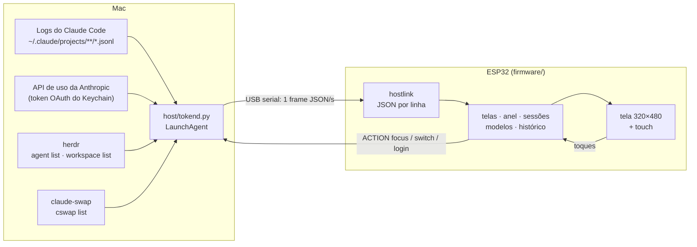

<p align="center">
  <picture>
    <source media="(prefers-color-scheme: dark)" srcset="docs/assets/wordmark-dark.svg">
    
  </picture>
</p>

<p align="center"><a href="https://gilsondev.github.io/tokenpulse/">Site do projeto</a> ·
<a href="https://github.com/gilsondev/tokenpulse/releases/latest">Baixar o firmware</a></p>

Um monitor de mesa para o uso do **Claude Code** (CLI e Desktop) numa tela ESP32 com touch. Ele mostra quanto
da janela de 5 h e da semana você já usou, quantos tokens estão passando por minuto, o que cada sessão está
fazendo e quanto esse uso custaria pela API. Tudo ao vivo, pela USB, sem Wi-Fi.

<p align="center">
  
</p>

> As capturas vêm do próprio aparelho (`host/shot.sh`) com o daemon em modo demonstração: org, sessões e
> números são fictícios.

## O que ele mostra

| | | |
|:-:|:-:|:-:|
|  |  |  |
| **Principal**: a janela de 5 h no anel (verde, amarelo a 70%, laranja a 80%, vermelho a 90%), a semana com o ritmo esperado, tokens do dia, tokens por minuto e a última hora. | **Sessões por workspace** do [herdr](https://herdr.dev), com quantas estão trabalhando, esperando você ou na sua vez. O workspace em foco no Mac ganha borda laranja. Sem herdr, as sessões vêm dos logs e se agrupam por projeto. | **Sessões** de um workspace, cada uma com um mascote no estado dela: anda trabalhando, pula na sua vez, treme quando precisa de aprovação, dorme parada. A sessão em foco tem borda; tocar num cartão traz a sessão para a frente no Mac (o painel do herdr no seu terminal, ou o Claude Desktop). |
|  |  |  |
| **Modelos** usados hoje e a fatia de cada um. | **Detalhe do modelo**: entrada, saída e cache, custo equivalente na API e os projetos que mais usaram. | **Histórico** de 14 dias; toque numa barra para ver o dia. |
|  |  |  |
| **Ajustes** pela engrenagem: brilho, escurecer quando parada, tema (segue o macOS), tela em pé ou deitada, ocultar custo. | **Trocar de org** pelo nome no topo, com o último % de cada uma. Usa o [claude-swap](https://github.com/realiti4/claude-swap) e pede dois toques, porque troca o login de todas as sessões do Mac. | **Sobre**: placa, firmware, recursos da placa, memória, conexão e reiniciar. |

<p align="center"></p>

Quando a janela de 5 h esgota e há outra org salva no claude-swap, a tela principal sugere a troca para a de
menor uso.

**Deitada.** Em Ajustes → Tela → horizontal, cada tela ganha uma versão deitada: o anel à esquerda, as sessões
em 3 colunas e o detalhe do modelo com os projetos ao lado.

<p align="center"></p>

**Na ESP32-2432S028R.** A placa de 2,8" (240×320, touch resistivo) roda as mesmas telas num layout
menor. No Sobre fica o botão para recalibrar o toque.

<p align="center"></p>

Também tem animações com mola nas barras e no anel, halo na ponta do progresso, transições deslizando entre
as telas, modo noite (22h–7h) e uma tela de diagnóstico quando o Mac some ("cabo USB / daemon / dados").

## Sessões: com ou sem herdr

O tokenpulse acompanha qualquer sessão do Claude Code: a CLI num terminal comum, o Claude Desktop e as sessões
abertas no [herdr](https://herdr.dev). O herdr é opcional e só acrescenta detalhes:

| | Sessões comuns (terminal, Desktop) | Sessões no herdr |
|---|---|---|
| Aparecem na tela | sim, as com atividade na última hora | sim, todos os painéis abertos |
| Tokens, modelos, custo, histórico | sim (dos logs do Claude Code) | sim |
| Estado (trabalhando, sua vez, parada) | estimado pelos logs | o do herdr, na hora |
| "Precisa de você" (esperando aprovação) | — | sim |
| Agrupamento | por projeto (pasta) | pelos workspaces do herdr |
| Nome no cartão | título da sessão ou pasta | o nome que você deu à aba |
| Sessão em foco e tocar para trazer à frente | Desktop: abre o app | sim, no painel do herdr |

As duas convivem: com o herdr rodando, as sessões de fora dele aparecem num grupo "fora do herdr".

## Como funciona



O Mac faz o trabalho pesado: o daemon `host/tokend.py` lê os logs do Claude Code, busca o % na mesma API que
o Claude Code usa e manda um frame por segundo. A placa só desenha, com fontes Inter suaves, anti-aliasing e
envio da tela em paralelo no segundo núcleo (~30 fps). As ações que a placa pede são uma lista fechada
(`focus`, `switch`, `login`): o daemon nunca executa texto vindo da serial.

## Dispositivos suportados

| Placa | Tela | Toque | Extras | Env do PlatformIO |
|---|---|---|---|---|
| [Guition JC3248W535](https://www.atomic14.com/esp32/boards/guition-jc3248w535/) (ESP32-S3 N16R8) | 3,5" IPS 320×480, AXS15231B QSPI | capacitivo | — | `guition-jc3248w535` (padrão) |
| [ESP32-2432S028R](https://github.com/witnessmenow/ESP32-Cheap-Yellow-Display), a "Cheap Yellow Display" (ESP32 sem PSRAM) | 2,8" 240×320, ST7789 | resistivo | LED RGB na cor da faixa | `cyd-2432s028r` |
| [Waveshare ESP32-S3-LCD-1.47B](https://www.waveshare.com/wiki/ESP32-S3-LCD-1.47B) | 1,47" 172×320, ST7789 | — (botão BOOT) | IMU (gira sozinha), LED RGB na cor da faixa | `waveshare-s3-lcd-147b` |

### Perfis: o que cada placa libera

A UI não pergunta o nome da placa. Ela decide por duas coisas:

- **A classe da tela**, pelo lado menor já girado. Abaixo de 220 px, ou sem touch, a UI é compacta: fontes
  bitmap e navegação por swipe ou botão. De 220 a 299 px é média e acima disso é grande. As duas têm todas
  as telas, os toques e a engrenagem; a média escala o layout pela altura e usa fontes de 12 a 40 px.
- **O perfil** (`board::PROFILE`, em [`boards/profile.h`](firmware/src/boards/profile.h)): `touch`, `calibrate`
  (touch resistivo), `imu` (gira sozinha), `led` (alerta de faixa) e `button`. A PSRAM é lida em tempo de execução: sem ela, a tela é
  desenhada em duas faixas de meia altura, a troca de tela não desliza e o texto não fica em cache.

| Placa | Classe | touch | calibrate | imu | led | button | PSRAM |
|---|---|---|---|---|---|---|---|
| Guition JC3248W535 | grande | sim | — | — | — | sim | 8 MB |
| ESP32-2432S028R | média | sim | sim | — | sim | sim | — |
| Waveshare 1,47" | compacta | — | — | sim | sim | sim | 8 MB |

Touch resistivo (`calibrate`): na primeira vez a placa pede quatro toques com a caneta, um em cada canto, e
guarda a calibração na memória dela, que sobrevive a reinício e OTA. Para refazer: Ajustes → Sobre →
**calibrar o toque**. A leitura só vale com pressão firme e é a mediana de 5 amostras, para tirar os pulos.

A tela Sobre mostra a placa, o perfil e a memória de quem está rodando.

**Em pé ou deitada** (Ajustes → Tela): as placas com touch têm uma versão horizontal de cada tela. O anel
vai para a esquerda, as sessões ficam em 3 colunas e os ajustes, o Sobre e a troca de org em 2. O toque gira
junto. A Guition não gira no painel: o quadro deitado é girado no envio, ainda na PSRAM.

### Como adicionar uma placa

Tudo que muda de um ESP para outro mora num header em `firmware/src/boards/`. O resto do firmware não sabe
qual placa está rodando.

1. Copie o header mais parecido para `boards/<sua_placa>.h`: `cyd_2432s028r.h` para LovyanGFX com touch,
   `waveshare_s3_lcd_147b.h` para LovyanGFX sem touch, `guition_jc3248w535.h` para outro driver.
2. Cumpra o contrato descrito em [`boards/board.h`](firmware/src/boards/board.h), dentro de `namespace board`:
   - `NAME` (igual ao env do PlatformIO; o daemon usa para achar o firmware no OTA), `DEFAULT_ROTATION`,
     `ROT_FOR`, `PROFILE` e `SERIAL_BAUD` (só conta com ponte USB-serial, como o CH340; use 460800).
   - Tela: `displayBegin`, `displaySetRotation`, `displayWidth/Height`, `setBrightness` e `displayPush`, que
     recebe linhas em RGB565 com o byte alto primeiro (o quadro inteiro com PSRAM, faixas sem). Use o driver
     que quiser (LovyanGFX, Arduino_GFX, esp_lcd).
   - Periféricos: `begin`, `gravity` (IMU), `setLed`, `buttonPressed`, `touch`. Recurso que a placa não tem vira
     função vazia (`return false`) e `false` no perfil.
3. Inclua o header no `#if` do `board.h`, com uma flag `-DBOARD_<SUA_PLACA>`.
4. Crie o env no `firmware/platformio.ini` com a flag e uma tabela de partições com duas partições de app,
   que o OTA precisa (`min_spiffs.csv` em 4 MB, `default_16MB.csv` em 16 MB).
5. Grave a primeira vez pela USB: `firmware/flash.sh <sua-placa> --usb`. Depois disso, o OTA pelo daemon.

## Releases do firmware

Cada tag `v*` gera um [release](https://github.com/gilsondev/tokenpulse/releases) pelo GitHub Actions com, por
placa, `tokenpulse-<placa>-factory.bin` (primeira gravação, imagem completa a partir do 0x0) e
`tokenpulse-<placa>-ota.bin` (atualização pelo daemon).

## Instalação

Requisitos no Mac: [uv](https://docs.astral.sh/uv/) e o Claude Code logado (`claude auth status`). Para
compilar o firmware em vez de usar o release, também o [PlatformIO](https://platformio.org/)
(`uv tool install platformio`).

Recomendados:
- [herdr](https://herdr.dev), para o estado real de cada sessão e o agrupamento por workspace. Instale a
  integração com `herdr integration install claude`. Sem herdr, o estado vem de uma estimativa pelos logs e as
  sessões ficam num grupo só.
- [claude-swap](https://github.com/realiti4/claude-swap) (`uv tool install claude-swap`), para trocar de org pela
  tela. Logado em cada org, rode `cswap add`.

Com a placa plugada:

```bash
git clone https://github.com/gilsondev/tokenpulse && cd tokenpulse
./setup.sh cyd-2432s028r      # ou guition-jc3248w535, waveshare-s3-lcd-147b
```

O `setup.sh` pausa o daemon se ele já roda, acha a porta da placa, grava o firmware do último release pela
USB (com o `--chip` certo, via `uvx esptool`) e liga o daemon no login do macOS (log em
`~/Library/Logs/tokenpulse.log`). Em alguns segundos a placa sai de "sem dados do Mac". A ESP32-2432S028R, de
touch resistivo, pede na primeira vez quatro toques com a caneta para calibrar. Gravar de novo apaga os ajustes
e a calibração.

O daemon roda direto da pasta clonada: mantenha a pasta onde está. Se mover ou apagar, a placa fica em "sem
dados do Mac"; para mudar de lugar, rode `host/install.sh` de novo a partir da pasta nova.

Atualizações depois disso vão por OTA, pelo mesmo cabo, e mantêm os ajustes e a calibração:

```bash
./update.sh                                    # todas as placas plugadas que estão atrás do último release
firmware/flash.sh cyd-2432s028r                # ou compila com o PlatformIO e manda (~40 s; Guition ~15 s)
firmware/flash.sh cyd-2432s028r --usb          # primeira gravação compilando da fonte, sem o release
```

O `update.sh` lê a versão de cada placa no que o daemon registrou (`~/.claude/esp-tokens-boards.json`),
baixa o `tokenpulse-<placa>-ota.bin` das que estão atrás e espera cada uma voltar na versão nova.

Opcional: aponte o `statusLine` do `~/.claude/settings.json` para `host/statusline.sh` (passe a sua statusline
atual como argumento para encadear). Ela serve de reserva do % quando a API de uso responde 429.

## Uso

- Arraste para os lados para trocar de tela; para cima e para baixo para ver mais sessões.
- Toque num workspace para ver as sessões e no título para voltar. Toque num modelo para o detalhe.
- Arraste da borda de baixo para cima (ou segure) para voltar à principal de qualquer tela.
- Toque no nome da org para trocar de org; na engrenagem para os ajustes.
- `uv run host/tokend.py --demo` manda dados fictícios, como nas capturas acima
  (`TOKENPULSE_DEMO_P5=86` muda o % da janela de 5 h).
- `host/shot.sh saida.png "page 1" "tap 80 90"` tira um screenshot da placa
  (comandos: `page N`, `tap X Y`, `swipe L|R|U|D`). Por padrão só funciona com o daemon em `--demo`; com os seus
  dados reais, rode `REAL=1 host/shot.sh …` e confira a imagem antes de publicar: ela mostra org, títulos de
  sessão e custos.
- `uv run host/tokend.py --once` imprime um frame com os seus dados reais: não cole em issues.

## Suporte de mesa

Em [`hardware/stand/alternativa`](hardware/stand/alternativa) há um suporte inclinado sem parafuso para a
Waveshare de 1,47", em OpenSCAD, inspirado no
[Waveshare ESP32-C6 1.47 Landscape stand](https://makerworld.com/en/models/3408098).

## Problemas conhecidos

- **A placa liga mas o Mac não a vê:** o USB-C da JC3248W535 só passa dados num dos lados. Gire o plugue.
- **Mais de uma placa plugada:** o `flash.sh --usb` grava na porta que já roda aquela placa ou na única sem o
  tokenpulse. Com duas placas novas, passe `--port /dev/cu.…`.
- **Outros aparelhos seriais plugados (Arduino, outro ESP32):** o daemon abre uma vez cada porta CH340 ou
  CP210x para perguntar se é uma placa do tokenpulse, e abrir a porta reinicia muitas dessas placas. Isso
  acontece quando a porta aparece e quando o daemon reinicia (`install.sh`, fim do `flash.sh --usb`). Uma
  ESP32 com USB nativa (S3) de outro projeto não reinicia, mas a porta dela é aberta de 5 em 5 s no primeiro
  minuto depois do plug e de 60 em 60 s depois disso, o que pode atrapalhar uma gravação. Para
  mexer em outro projeto serial sem interferência, pare o daemon:
  `launchctl bootout gui/$UID/com.gilsondev.tokenpulse` (e `host/install.sh` para religar).
- **Placa com ponte USB-serial plugada antes de ter o firmware:** pelo motivo acima, o daemon não pergunta de
  novo até ela ser replugada. O `flash.sh --usb` reinicia o daemon no fim, então o fluxo normal não esbarra nisso.
- **Placa não volta depois do OTA:** o `flash.sh` avisa quando ela não se apresenta em 75 s. Um firmware que
  trava no boot do S3 pode travar também o reset pela USB, e aí nem o `--usb` grava. O JTAG embutido na USB
  do S3 ainda funciona, sem botão e sem abrir o case:
  `pio pkg install -g -t platformio/tool-openocd-esp32` e depois
  `openocd -f board/esp32s3-builtin.cfg -c "program_esp firmware.bin 0x10000 verify reset exit"`
  (grave também `bootloader.bin` em 0x0, `partitions.bin` em 0x8000 e o `boot_app0.bin` em 0xe000 para voltar à
  partição de app 0).
- **Screenshot da CYD falha às vezes:** pelo CH340 o macOS perde alguns bytes da placa para o Mac. O daemon
  tenta de novo; o OTA e os frames vão no outro sentido e não sofrem com isso.
- **"atualizado há N min" no anel:** a API de uso respondeu 429. O daemon respeita o `Retry-After` (ou dobra a
  espera, até 30 min) e guarda o último % em `~/.claude/esp-tokens-usage.json`.
- **"janela nova · 17h" com 0%:** a janela de 5 h acabou de virar; o primeiro % aparece em alguns minutos.
- **Gravar por cima do firmware [Tessera](https://github.com/gilsondev/Tessera):** ele trava o CS da tela com
  `gpio_hold`, e o firmware daqui solta a trava no boot. Para entrar no bootloader sem botões, mande `FLASH` pela
  serial e abra a porta a 1200 baud.
- **Custo:** é o equivalente pela tabela de preços da API, não o que a assinatura cobra.

## Licença

[MIT](LICENSE). A fonte Inter em `firmware/tools/fonts` e os headers gerados dela seguem a SIL OFL 1.1.

## Créditos

[LovyanGFX](https://github.com/lovyan03/LovyanGFX), [Arduino_GFX](https://github.com/moononournation/Arduino_GFX),
[ArduinoJson](https://arduinojson.org/) e a fonte [Inter](https://rsms.me/inter/) (SIL OFL 1.1,
`firmware/tools/fonts/OFL.txt`). Feito com o Claude Code.
