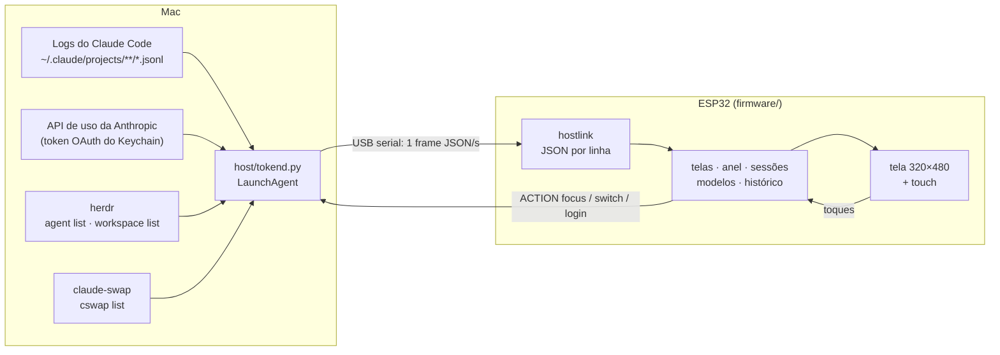

# tokenpulse

Um monitor de mesa para o uso do **Claude Code** (CLI e Desktop) numa tela ESP32 com touch. Ele mostra quanto
da janela de 5 h e da semana você já usou, quantos tokens estão passando por minuto, o que cada sessão está
fazendo e quanto esse uso custaria pela API. Tudo ao vivo, pela USB, sem Wi-Fi.

<p align="center">
  
</p>

> As capturas vêm do próprio aparelho (`host/shot.sh`) com o daemon em modo demonstração: org, sessões e
> números são fictícios.

## O que ele mostra

| | | |
|:-:|:-:|:-:|
|  |  |  |
| **Principal**: a janela de 5 h no anel (verde, amarelo a 70%, laranja a 80%, vermelho a 90%), a semana com o ritmo esperado, tokens do dia, tokens por minuto e a última hora. | **Sessões por workspace** do [herdr](https://herdr.dev), com quantas estão trabalhando, esperando você ou na sua vez. O workspace em foco no Mac ganha borda laranja. Sem herdr, as sessões vêm dos logs e se agrupam por projeto. | **Sessões** de um workspace, cada uma com um mascote no estado dela: anda trabalhando, pula na sua vez, treme quando precisa de aprovação, dorme parada. A sessão em foco tem borda; tocar num cartão traz a sessão para a frente no Mac (o painel do herdr no seu terminal, ou o Claude Desktop). |
|  |  |  |
| **Modelos** usados hoje e a fatia de cada um. | **Detalhe do modelo**: entrada, saída e cache, custo equivalente na API e os projetos que mais usaram. | **Histórico** de 14 dias; toque numa barra para ver o dia. |
|  |  |  |
| **Ajustes** pela engrenagem: brilho, escurecer quando parada, tema (segue o macOS), girar 180°, ocultar custo. | **Trocar de org** pelo nome no topo, com o último % de cada uma. Usa o [claude-swap](https://github.com/realiti4/claude-swap) e pede dois toques, porque troca o login de todas as sessões do Mac. | **Sobre**: placa, firmware, memória, conexão e reiniciar. |

<p align="center"></p>

Quando a janela de 5 h esgota e há outra org salva no claude-swap, a tela principal sugere a troca para a de
menor uso.

Também tem animações com mola nas barras e no anel, halo na ponta do progresso, transições deslizando entre
as telas, modo noite (22h–7h) e uma tela de diagnóstico quando o Mac some ("cabo USB / daemon / dados").

## Como funciona



O Mac faz o trabalho pesado: o daemon `host/tokend.py` lê os logs do Claude Code, busca o % na mesma API que
o Claude Code usa e manda um frame por segundo. A placa só desenha, com fontes Inter suaves, anti-aliasing e
envio da tela em paralelo no segundo núcleo (~30 fps). As ações que a placa pede são uma lista fechada
(`focus`, `switch`, `login`): o daemon nunca executa texto vindo da serial.

## Dispositivos suportados

| Placa | Tela | Toque | Extras | Env do PlatformIO |
|---|---|---|---|---|
| [Guition JC3248W535](https://www.atomic14.com/esp32/boards/guition-jc3248w535/) (ESP32-S3 N16R8) | 3,5" IPS 320×480, AXS15231B QSPI | capacitivo | — | `guition-jc3248w535` (padrão) |
| [Waveshare ESP32-S3-LCD-1.47B](https://www.waveshare.com/wiki/ESP32-S3-LCD-1.47B) | 1,47" 172×320, ST7789 | — (botão BOOT) | IMU (gira sozinha), LED RGB na cor da faixa | `waveshare-s3-lcd-147b` |

A tela de 320×480 em retrato usa as telas grandes (as das capturas). Telas pequenas usam layouts compactos;
outras resoluções caem no layout compacto escalado, que serve de ponto de partida.

### Como adicionar uma placa

Tudo que muda de um ESP para outro mora num header em `firmware/src/boards/`. O resto do firmware não sabe
qual placa está rodando.

1. Copie o header mais parecido (`guition_jc3248w535.h` para telas grandes com touch,
   `waveshare_s3_lcd_147b.h` para LovyanGFX) para `boards/<sua_placa>.h`.
2. Cumpra o contrato descrito em [`boards/board.h`](firmware/src/boards/board.h), dentro de `namespace board`:
   - `NAME` (igual ao env do PlatformIO; o daemon usa para achar o firmware no OTA), `DEFAULT_ROTATION`, `ROT_FOR`.
   - Tela: `displayBegin`, `displaySetRotation`, `displayWidth/Height`, `setBrightness` e `displayPush`, que
     recebe o quadro inteiro em RGB565 com o byte alto primeiro. Use o driver que quiser (LovyanGFX,
     Arduino_GFX, esp_lcd).
   - Periféricos: `begin`, `gravity` (IMU), `setLed`, `buttonPressed`, `touch`. Recurso que a placa não tem vira
     função vazia (`return false`).
3. Inclua o header no `#if` do `board.h`, com uma flag `-DBOARD_<SUA_PLACA>`.
4. Crie o env no `firmware/platformio.ini` com a flag, a memória da placa e uma tabela de partições com duas
   partições de app (`default.csv` em 4 MB, `default_16MB.csv` em 16 MB), que o OTA precisa. Tela acima de
   ~240×240 pede PSRAM: o canvas usa largura × altura × 2 bytes, em dobro.
5. Grave a primeira vez pela USB: `firmware/flash.sh <sua-placa> --usb`. Depois disso, o OTA pelo daemon.

## Releases do firmware

Cada tag `v*` gera um [release](https://github.com/gilsondev/tokenpulse/releases) pelo GitHub Actions com, por
placa, `tokenpulse-<placa>-ota.bin` (para o OTA) e `tokenpulse-<placa>-factory.bin` (primeira gravação):

```bash
esptool.py --chip esp32s3 write_flash 0x0 tokenpulse-guition-jc3248w535-factory.bin
```

## Instalação

Requisitos no Mac: [uv](https://docs.astral.sh/uv/), [PlatformIO](https://platformio.org/)
(`uv tool install platformio`) e o Claude Code logado (`claude auth status`).

Recomendados:
- [herdr](https://herdr.dev), para o estado real de cada sessão e o agrupamento por workspace. Instale a
  integração com `herdr integration install claude`. Sem herdr, o estado vem de uma estimativa pelos logs e as
  sessões ficam num grupo só.
- [claude-swap](https://github.com/realiti4/claude-swap) (`uv tool install claude-swap`), para trocar de org pela
  tela. Logado em cada org, rode `cswap add`.

```bash
host/install.sh                                # daemon no login do macOS (log em ~/Library/Logs/tokenpulse.log)
firmware/flash.sh --usb                        # primeira gravação, pela USB
firmware/flash.sh                              # as próximas: OTA pela serial, ~15 s
```

Opcional: aponte o `statusLine` do `~/.claude/settings.json` para `host/statusline.sh` (passe a sua statusline
atual como argumento para encadear). Ela serve de reserva do % quando a API de uso responde 429.

## Uso

- Arraste para os lados para trocar de tela; para cima e para baixo para ver mais sessões.
- Toque num workspace para ver as sessões e no título para voltar. Toque num modelo para o detalhe.
- Arraste da borda de baixo para cima (ou segure) para voltar à principal de qualquer tela.
- Toque no nome da org para trocar de org; na engrenagem para os ajustes.
- `uv run host/tokend.py --demo` manda dados fictícios, como nas capturas acima
  (`TOKENPULSE_DEMO_P5=86` muda o % da janela de 5 h).
- `host/shot.sh saida.png "page 1" "tap 80 90"` tira um screenshot da placa
  (comandos: `page N`, `tap X Y`, `swipe L|R|U|D`). Por padrão só funciona com o daemon em `--demo`; com os seus
  dados reais, rode `REAL=1 host/shot.sh …` e confira a imagem antes de publicar: ela mostra org, títulos de
  sessão e custos.
- `uv run host/tokend.py --once` imprime um frame com os seus dados reais: não cole em issues.

## Suporte de mesa

Em [`hardware/stand/alternativa`](hardware/stand/alternativa) há um suporte inclinado sem parafuso para a
Waveshare de 1,47", em OpenSCAD, inspirado no
[Waveshare ESP32-C6 1.47 Landscape stand](https://makerworld.com/en/models/3408098).

## Problemas conhecidos

- **A placa liga mas o Mac não a vê:** o USB-C da JC3248W535 só passa dados num dos lados. Gire o plugue.
- **"atualizado há N min" no anel:** a API de uso respondeu 429. O daemon respeita o `Retry-After` (ou dobra a
  espera, até 30 min) e guarda o último % em `~/.claude/esp-tokens-usage.json`.
- **"janela nova · 17h" com 0%:** a janela de 5 h acabou de virar; o primeiro % aparece em alguns minutos.
- **Gravar por cima do firmware [Tessera](https://github.com/gilsondev/Tessera):** ele trava o CS da tela com
  `gpio_hold`, e o firmware daqui solta a trava no boot. Para entrar no bootloader sem botões, mande `FLASH` pela
  serial e abra a porta a 1200 baud.
- **Custo:** é o equivalente pela tabela de preços da API, não o que a assinatura cobra.

## Créditos

[LovyanGFX](https://github.com/lovyan03/LovyanGFX), [Arduino_GFX](https://github.com/moononournation/Arduino_GFX),
[ArduinoJson](https://arduinojson.org/) e a fonte [Inter](https://rsms.me/inter/) (SIL OFL 1.1,
`firmware/tools/fonts/OFL.txt`). Feito com o Claude Code.
